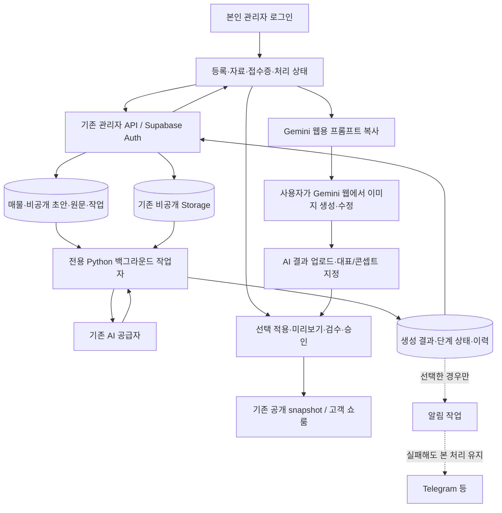

# SpacePick 관리자 웹 중심 전환 실행계획

기준일: **2026-11-07, 한국시간**. 코드 점검 기준 commit `320d53e9a1d8ef67b7d93340251fd94993342a41`, 브랜치 `feature/spacepick-v2-1`.

이번 요청은 정밀한 계획 작성이다. 이 문서는 구현 범위·선행 조건·작업 순서·합격 기준을 정하며, 이번 작업에서 기능 코드·운영 설정·DB·사이트를 변경하지 않는다. 아래 제안 스키마/API/화면은 실제 구현 및 운영 검증 전이다. 기존 S0~S6, 문안 재작성, 이미지 프롬프트의 로컬 완료 상태는 유지한다.

## 1. 결정과 완료 모습

매물의 주 입력·진행 확인·수정·승인 창구를 관리자 웹으로 통합한다. 운영의 정상 처리 경로에서 Telegram 수신과 GitHub workflow dispatch를 제거한다. GitHub는 소스·검사·배포를 맡고, DB에 저장한 작업은 전용 백그라운드 작업자가 처리한다. Telegram은 희망 시 완료 알림만 사용하며, 알림 실패는 매물 저장/AI 처리 성공을 취소하지 않는다.

고객에게 보이는 기존 쇼룸·URL·승인 snapshot은 그대로 유지한다. 운영자 본인 전용 검증 환경에서 먼저 전환을 시험한다. 로그인·매물 상태·자료 권한을 우회하는 공개 테스트 페이지를 만들지 않는다.

첫 운영 전환의 합격 모습:

1. 관리자 웹에서 간단 입력 또는 자료로 등록하고 저장 번호를 받는다.
2. 화면을 닫거나 AI가 실패해도 서버에 저장된 입력과 첨부를 다시 연다.
3. 대기/진행/완료/확인 필요를 웹에서 확인하고 실패 단계만 재시도한다.
4. 생성된 문구·자료 추출 후보·활용 콘셉트를 검토하고 선택 적용한다.
5. 필요하면 다시 글작성 또는 Gemini 웹용 이미지 프롬프트를 사용한다.
6. 수동 이미지도 AI 예상도라는 분류와 출처를 유지하며 올린다.
7. 직접 검수·승인한 내용만 고객에게 공개한다.
8. 위 과정이 Telegram 키·GitHub dispatch 토큰 없이 작동한다. 코드 배포용 GitHub 권한과 AI/DB 자격증명은 별도다.

## 2. 코드로 확인한 현재 상태

아래의 구현 완료는 로컬 기준이다. 운영에 동일 버전이 적용되었다고 확인한 것은 아니다. 사용자가 보고한 최근 무응답 사건의 직접 원인은 이번 계획 작업에서 원격 로그로 진단하지 않았다.

| 영역 | 확인한 코드 | 현재와 전환 시 필요한 일 |
| --- | --- | --- |
| 웹 등록 | `NewPropertyForm.tsx`, `_shared/web-registration.ts` | 유형/주소/면적·금액/담당자·권한, 비공개 임시 저장 구현. 접수증·재개·입력 모드 개선에 재사용 |
| 원자적 저장 | `20261105140000_web_property_registration.sql` | 매물/초안/웹 접수/미실행 작업을 한 번에 생성, request ID 중복 방지. 미완성 매물은 작업 시간이 infinity라 자동 분석하지 않음 |
| 웹 자료 | `PropertyMedia.tsx`, `showroom-assets`, `document_sources.py` | 사진/도면/PDF 보관 가능. 현재 웹 분석 입력은 선택 PDF 중심이며, 웹 사진의 AI 판독이 완성됐다고 보지 않음 |
| AI 시작 | `showroom-admin`의 `queue-web-analysis`, `_shared/plan-queue.ts` | DB 큐 저장 후 `agent.yml`의 main dispatch에 의존. 전용 작업자 경로로 전환 필요 |
| 텍스트 분석 | `analysis_worker.py`, `property_analysis_jobs` | claim/lease/재시도·구조 검증 재사용. 사용자 상태 API·입력 snapshot·작업 이력 보완 필요 |
| 숨은 결합 | `analysis_worker.py`의 finally, `scripts/sync_telegram_media.py` | 후처리에서 Telegram 토큰을 요구하는 MediaClient를 생성함. 이 실패가 뒤의 도면/이미지 처리로 전파될 수 있으므로 웹 처리와 분리 |
| Telegram 진단 | `scripts/check_intake_health.py` | Telegram 진단이 workflow에 있음. 진단 스크립트는 대체로 오류를 잡아 출력하므로 이것만으로 웹 작업 중단 원인이라고 단정하지 않음 |
| 기존 원문 | `webAnalysisInput`, `web_queue_analysis` | 현재 편집 요약이 분석 입력에 들어가고 `properties.raw_input`이 작업 입력으로 갱신됨. 원문/생성문/요청 snapshot의 역할을 분리해야 함 |
| 도면 처리 | `plan_analysis.py`, `draft_content.planAnalysis` | 현재 JSON 표시와 조회 흐름. 여러 실행자 이전 시 원자적 claim/lease가 있다고 가정하지 말고 먼저 보완 |
| 이미지 | `image_worker.py`, image jobs/budgets | `visualMode=ai_generated` 초안의 대표/콘셉트를 자동 enqueue하는 흐름 존재. 새 수동 기본 정책과 충돌하므로 서버 측 제어 필요 |
| 다시 글작성 | `copy_rewrite_worker.py`, `property_copy_rewrites`, `copy-rewrite.yml` | 비교/선택 적용·회수 제한 구현. 실행자는 GitHub Actions여서 새 작업자로 이전해야 함 |
| 이미지 프롬프트 | `ImagePromptPanel`, `_shared/image-prompts.ts` | 현재 편집값의 무료 텍스트 구성·복사/다운로드 구현. 관리자 화면에서 그대로 재사용 |
| 수동 이미지 첨부 | `PropertyMedia.tsx` | 일반 업로드가 `owner_provided`를 사용함. Gemini 출력물을 이 경로로 그대로 올려 실제 사진처럼 분류하면 안 됨. 별도 AI 결과 업로드·배치 연결 보완 필요 |
| 승인/고객 화면 | revision/CAS, published snapshot, public DTO | 재사용. worker 완료가 기존 승인·게시를 수행하지 않도록 유지 |
| 시험 환경 | `SPACEPICK_PRIVATE_PREVIEW_PLAN.md` | 본인 계정/데이터 분리·관리 연결·운영 버전 확인은 아직 미완료. 실제 제공자/권한을 확인하고 진행 |

현재 확인된 마지막 로컬 baseline은 통합 **38항목(Python 65, Node 152, 격리 SQL 7, 빌드/Edge 타입)**이다. 이 계획서 작성 때문에 해당 기능 검사를 새로 실행하거나 통과 수를 늘리지 않는다.

## 3. 목표 구성

- 정기 GitHub 실행이 없어도 새 작업이 처리되어야 한다. 기존 Actions 정기 실행은 이전 기간에 명시적으로 분리한 legacy 작업만 맡는다.
- 웹 요청은 저장/작업 접수 후 끝낸다. PDF 처리·AI 응답이 끝날 때까지 브라우저의 한 HTTP 요청을 붙잡지 않는다.
- 초기 전용 작업자는 기존 Python 코드를 재사용하는 작은 단일 서비스로 시작한다. 부하를 측정하기 전 Redis·별도 메시지 브로커·쿠버네티스 등은 추가하지 않는다.

## 4. 입력 화면과 저장 기준

### A. 간단 입력

- 직접 입력과 매물 설명 붙여넣기를 같은 시작 화면에서 제공한다.
- 매물명/유형/주소/거래방식, 선택 면적과 면적 종류, 가격/협의/미확인, 원문 설명, 담당자·권한을 입력한다.
- 모르는 값은 빈 값 또는 확인 필요로 저장한다. 매매·보증금·월세의 단위와 대지/건축/연면적을 분리한다. `300억`, `1,000평` 같은 표현은 원문을 보존하고 변환 후보를 확인시킨다. 임의의 단위 추정·반올림 확정은 하지 않는다.
- 입력 원문은 고객에게 공개할 요약과 별도 영역이다. 사람이 수정한 원문도 이전 분석의 입력으로 덮어쓰지 않고 다음 실행의 새 source revision으로 남긴다.
- 주소·면적·가격이 부족해도 임시 저장을 허용한다. 사용 권한이 부족하면 AI 시작을 막고, 게시 필수 조건은 기존 서버 규칙으로 검사한다.

### B. 자료로 등록

- 유형 미확정·소재지 미확인 상태의 비공개 매물을 먼저 만들고 사진·도면·PDF를 올린다. 중간 등록을 위해 없는 주소/수치를 입력하게 하지 않는다.
- 파일별 업로드 중/보관 완료/실패/분석 제외를 표시한다. 하나가 실패해도 나머지 파일과 매물은 보존한다.
- 사용자가 분석할 자료를 선택하고 권한을 확인한 뒤 **자료 읽고 초안 작성**을 요청한다.
- 현재 PDF 인용·값 후보/충돌·페이지 검토 기능을 재사용한다. 기본 분석에서 추출과 문안 초안을 함께 반환하고 사람이 후보를 확인한다. 확인 전후마다 전체 유료 분석을 의무적으로 두 번 실행하지 않는다.
- 스캔 PDF는 실제 텍스트 대조가 안 됐음을 표시한다. OCR/사진 판독은 지원 여부를 분리하고, 필요 시 추가 선택 작업으로 구현한다. 글자가 보인다는 이유로 구조·치수·진입 권리를 검증했다고 표시하지 않는다.
- 웹 사진은 기존 첨부 보관부터 이용한다. 사진을 AI 입력으로 보내는 경로는 별도로 구현·검증하기 전 “사진까지 분석 완료”로 표시하지 않는다. 도면 구조 분석은 사용자 선택 단계로 둔다.

### 입력 보존과 접수증

1. 신규 등록 시작 시 비공개 서버 초안을 만들고, 이후 변경은 revision을 확인해 저장한다. 초기 생성 request UUID는 재시도에도 유지한다.
2. 최초 저장 이후 1~2초 지연 저장과 명시적 저장을 조합한다. 서버 응답 전에는 저장 완료로 표시하지 않는다. 저장 중/저장 완료 시각/저장 실패를 항상 보여준다.
3. 응답 유실 시 같은 request UUID로 저장 여부를 조회·복구한다. 다른 내용으로 같은 요청을 재사용하거나 새 UUID를 만들어 중복 등록하지 않는다.
4. `sessionStorage`는 재개할 request/property 식별자 정도로 제한한다. 원문·연락처·문서를 장기간 브라우저 저장소에 자동 복제하지 않는다. 마지막 서버 저장 전 브라우저가 종료된 편집까지 복구된다고 보장하지 않는다.
5. 완료 화면에 매물 번호·저장 시각·파일별 결과·현재 처리 상태·다시 열기를 제공한다. 예: **“비공개로 저장했습니다. 매물 SP-… / 분석 대기”**.
6. 저장 자체가 실패하면 입력 화면을 유지한다. 서버에 저장되었는지 불명확한 상태는 확인 중으로 표시하고, 허위 접수 번호나 완료 안내를 만들지 않는다.

## 5. 작업 현황 화면과 상태 정의

목록의 기본 항목: 매물명/유형, 최근 저장 시각, 문안 처리 상태, 이미지 준비 방식/상태, 공개 상태, 확인할 문제, 다시 열기. 내부 오류 코드·workflow 이름을 고객 작업 순서에 노출하지 않는다.

| 화면 상태 | 판단 근거 | 가능한 행동 |
| --- | --- | --- |
| 임시 저장 | 비공개 초안 존재, AI 요청 없음 | 이어 쓰기·자료 첨부·분석 요청 |
| 업로드 확인 필요 | 선택 파일 중 업로드/검증 실패 | 실패 파일만 재업로드 또는 분석 제외 |
| 분석 대기 | DB에 작업 접수, 아직 claim되지 않음 | 화면 닫기/다시 열기, 시작 전 취소 |
| 분석 중 | 유효한 worker claim·단계 갱신 | 단계/최근 갱신 확인. 반복 요청 차단 |
| 자동 재시도 대기 | 일시 오류, 다음 시도 시각·남은 회수 존재 | 예상 재시도 시각 확인, 중복 요청 차단 |
| 초안 검토 가능 | 검증된 구조의 결과가 저장됨 | 문안/추출 후보 검토·선택 적용·재작성 |
| 자료 확인 필요 | 암호/손상/인용 불일치·충돌/미제공 | 원문 확인·파일 교체·입력 보완 후 해당 단계 재시도 |
| 처리 지연 | worker heartbeat 중단 또는 오래된 단계 갱신 | 자료 보존 안내·재확인. 진행률을 임의 증가시키지 않음 |
| 처리 실패 | 영구 오류 또는 재시도 소진 | 쉬운 이유·보존 상태·가능한 재시도 제공 |
| 취소됨 | 취소가 서버에서 확정됨 | 다시 요청, 기존 결과 검토 |

문안/도면/이미지/공개 상태는 별도로 표시한다. 문안이 완료됐다고 이미지·사실 검증·게시까지 완료한 것으로 합치지 않는다. 이미지가 선택 작업인 매물은 이미지 대기로 문안 검토를 막지 않는다. 가짜 백분율 대신 **자료 확인 → 문안 작성 → 결과 저장**처럼 관측 가능한 단계와 마지막 갱신 시각을 보여준다.

오류 문구 예:

- “자료는 저장되어 있습니다. AI 서비스 연결이 지연되어 다시 시도합니다.”
- “암호가 설정된 PDF를 읽지 못했습니다. 암호 없는 파일로 교체하거나 분석에서 제외해 주세요.”
- “저장 후 다른 수정이 있어 결과를 바로 적용할 수 없습니다. 최신 초안과 비교해 주세요.”
- “이미지 처리만 실패했습니다. 작성된 문안은 유지됩니다.”

## 6. 데이터·API 설계 방향

다음은 신규 제안 계약이다. 이 문서만으로 기존 DB에 열/테이블이 생긴 것은 아니다. W2에서 실제 스키마·migration 이력을 다시 대조하고 additive SQL로 확정한다.

| 대상 | 재사용/추가 제안 | 규칙 |
| --- | --- | --- |
| 매물·초안 | 기존 properties / property_showrooms | ID·slug·revision·승인 snapshot 유지 |
| 웹 원문 | 기존 property_web_intakes에 versioned `input_payload`, `source_revision`, 수정 시각 추가 | 입력 모드·제공 원문 등 원자료만. 숫자/출처의 주 저장소는 기존 propertyProfile·문서 후보이며 중복 테이블을 만들지 않음 |
| 접수 재개 | 기존 actor/request UUID와 조회 계약 확장 | 같은 사용자·같은 내용 재전송은 같은 매물, 다른 내용 충돌은 명시 처리 |
| 처리 실행 이력 | private `property_processing_runs` 추가 제안 | run ID, property ID, 인증된 요청자 ID, kind, request ID, source/draft revision, 선택 asset ID+digest/version, 입력 snapshot, 결과 참조, 상태/단계/시도/시간/안전 오류 코드 |
| 기존 실제 큐 | analysis/image/copy queues와 run 이력 연결 | 이미 있는 큐를 중복 구현하지 않음. 큐 상태가 실행의 주 상태이며 이력은 같은 트랜잭션/RPC에서 갱신해 불일치 방지 |
| 실행자 구분 | 큐에 `executor_kind` 및 소유 전환 version 제안 | legacy_actions / web_worker. 미전환 기존 값은 legacy로 두고 승인된 대상만 전환 |
| 작업자 상태 | private heartbeat 테이블 또는 동등한 저장 | worker ID·버전·환경·마지막 생존·처리 종류. 브라우저에는 필요한 정상/지연 정보만 투영 |
| 도면 작업 | 기존 planAnalysis 표시와 durable claim 연결 | JSON 표시만으로 실행자 동시성을 보장하지 않음. 원자적 claim/lease·run 연결부터 구현 |
| 이미지 정책 | draft의 versioned 이미지 정책과 슬롯별 수동 지정 | 수동/API 선택, 실제/AI 분류, 선택 slot과 참조. 공개는 기존 승인 DTO 규칙 유지 |

공통 이력이 기존 문안 재작성의 원문/결과 이력을 다시 복제하는 저장소가 되지 않게 한다. 재작성·이미지 큐가 이미 가진 ID/시도/결과는 참조·집계하고, 신규 실행 이력은 특히 한 행으로 덮어쓰는 최초 분석의 입력 보존·실행 구분을 보완한다. 원본 PDF/사진 바이트를 이력 테이블에 복사하지 않으며 로그에는 원문·연락처·키·서명 URL을 남기지 않는다. 보관/정리 정책은 기존 원본과 작업 복구 이력을 구분해 확정한다.

제안 관리자 API(기존 `showroom-admin` action 확장 우선):

- 저장/복구: 기존 create-property/save-draft 재사용, request UUID로 본인의 접수 결과 조회.
- 상태: 매물별 처리 요약/최근 run·단계·안전한 오류/재시도 시각. 원문·키·claim token·worker 비밀값은 반환하지 않는다.
- 요청: 최초 분석, 도면 선택 분석, 문안 재작성, API 이미지 생성 등 종류를 명시하고 request ID·revision·선택 자료·사용 권한을 검증한다.
- 재시도/취소: 완료·현재 진행·재시도 대기·영구 오류를 구분한다. 다시 글작성과 실패 단계 재시도를 같은 API로 뭉개지 않는다.
- 결과: 실행 시점의 revision과 현재 초안을 대조해 비교/선택 적용한다. 자료가 바뀌었거나 취소된 작업은 늦은 응답으로 적용하지 않는다.
- 수동 이미지: 기존 이미지 업로드·권한 계약을 확장하되 AI 결과 분류와 slot 지정은 서버가 검증한다.

## 7. 백그라운드 작업자 운영

### 실행 환경

- 기존 Python 분석·문안 편집·이미지 예산/공급자 검증 코드를 작은 실행 함수로 분리하고 장시간 살아 있는 서비스가 DB 큐를 확인한다.
- 기존 운영 서버에서 안전하게 실행 가능한지 우선 확인한다. 없으면 관리형 background worker 또는 소형 VM의 자격증명/비공개 네트워크/자동 재시작/월 유지비를 비교해 선정한다. 현재 호스팅 Worker가 장시간 Python AI 작업을 실행할 수 있다고 가정하지 않는다.
- 최초 설계 출발점은 1개 작업자·AI 작업 동시성 1이다. 메모리/CPU는 실제 PDF·이미지 샘플로 측정해 정하며 사양·무료 운영을 보장하지 않는다.
- 시작 시 필수 DB/AI 연결과 환경별 프로젝트 일치를 검사한다. 실패 상태를 기록하되 입력 API의 비공개 저장까지 막지 않는다.
- 필요한 기능별 자격증명만 검사한다. 텍스트 공급자를 다른 기존 공급자로 선택한 수동 이미지 매물에 Gemini 이미지 키를 무조건 요구하지 않으며, 미사용 이미지/알림 기능 때문에 문안 결과 저장을 실패시키지 않는다.
- 기존 코드의 고정 Supabase URL 검사·프런트 API URL·Auth redirect를 환경별 검증된 설정으로 바꿔 시험/운영 DB 혼용을 막는다. 프로젝트 검증을 없애는 방식으로 해결하지 않는다.

### 실행/실패 규칙

1. 초기에 3~5초 큐 확인, 유휴 시 제한된 backoff를 적용한다. 별도 GitHub dispatch를 정상 실행의 조건으로 두지 않는다.
2. claim은 DB의 원자적 잠금과 token으로 획득한다. 초기 lease는 기존 10분 보호를 출발점으로 삼고, 갱신 간격/단계별 최대 실행시간을 측정 후 확정한다. heartbeat와 claim 갱신은 AI 응답 대기로 막히지 않게 한다.
3. 같은 run은 한 유효 실행자만 완료시킨다. lease 소실/취소/라우팅 세대 변경 뒤 도착한 응답은 저장·적용을 거절한다.
4. 재시도는 현재 분석 최대5회·문안 재작성 최대3회 및 이미지 예산 보호를 우선 유지한다. 한도 변경은 구현 중 별도 근거와 회귀 검사를 남긴다. 프로세스 재시작으로 시도/예산이 초기화되지 않는다.
5. 전송 오류/일시적 과부하는 대기 후 재시도, 인증/자료 손상/동의 부족은 사용자 확인으로 분리한다. 결과 저장 실패를 AI 실패로 바꿔 그 자리에서 다시 유료 생성하지 않는다.
6. 외부 AI 호출의 정확히 한 번 청구는 보장할 수 없다. 응답 유실은 불확실 상태로 기록하고 provider 지원 범위의 요청 식별/복구를 검토한다. 특히 이미지의 비환급 예약 예산을 재시도로 되돌리지 않는다.
7. 문안 성공 뒤 도면/이미지가 실패해도 성공 결과를 유지한다. Telegram 수신자료 동기화, 완료 알림, PDF/도면, 이미지 처리의 예외를 한 finally에 연쇄 연결하지 않는다.
8. 반복 후처리/승인본 자동 갱신을 막는다. 처리 결과 저장과 초안 적용/공개 승인은 서로 다른 단계다.

## 8. 이미지와 비용 정책

**새 웹 등록의 권장 기본값은 Gemini 웹을 이용한 수동 이미지 준비다.** 이는 이번 사용자 흐름에 대한 제안이며 현재 코드의 자동 enqueue를 이미 해제했다는 뜻이 아니다.

- 수동 방식: 기존 이미지 프롬프트 복사 → 사용자가 Gemini 웹에서 생성/수정 → 검토실의 **AI 결과 업로드** → 원본과 비교 → 대표/콘셉트 지정 → 별도 승인.
- API 방식: 명시적으로 선택한 매물/슬롯만 기존 작업/예산으로 요청. 초안 생성·파일 업로드·문안 재작성 자체가 이미지 생성 요청이 되지 않도록 서버에서 검사한다.
- 전환 전 생성해 둔 이미지나 진행 중인 유료 작업은 자동 삭제/다시 생성하지 않는다. 전환 시 기존 큐와 예약 예산을 먼저 목록화한다.
- Gemini 웹 결과는 `ai_generated`와 활용 예상도 분류를 유지한다. 실제 현장사진 원본은 별도다. 업로드자가 적은 모델 이름은 사용자 기재 출처로 보관하고 검증된 API 실행 기록으로 위장하지 않는다.
- 수동 교체 slot은 후속 자동 asset sync에서 덮어쓰지 않도록 server-side override/참조 우선순위를 정한다. 원본/작업 이력은 남기고 재지정은 명시적 저장으로 처리한다.
- 현재 이미지 UI/worker의 500원 예약, 매물 기본2500원 등은 안전 한도다. 실제 장당 가격·환율·세금 또는 Gemini 구독 제공량으로 해석하지 않는다. 이번 전환이 그 한도를 자동 인상하지 않는다.
- 전용 서버의 유지비, 텍스트/문서 AI 호출 비용, 선택 API 이미지 비용을 분리해 운영 화면·문서에 설명한다. Google One 구독이 API 비용이나 서버 유지비를 포함한다고 가정하지 않는다.

## 9. 기존 자료와 Telegram 이전

- 기존 Telegram 등록 매물을 새로 복사하지 않는다. 기존 ID로 관리자 목록에서 열고 신규 웹 등록과 같은 편집·검토 화면을 사용한다.
- Telegram 첨부가 아직 FILE_ID에만 남아 있는지 확인한다. 필요한 자료는 기존 동기화 코드를 이전 도구로 사용해 private Storage에 확보하고 asset/property 소속·파일 digest를 검증한다. 원본 없이 현장사진을 대신 생성하지 않는다.
- 미확보 자료는 “이전 자료 확인 필요”로 표시한다. 확보되지 않은 Telegram 토큰/원본이 새 웹 매물의 처리를 막지 않는다.
- 승인된 공개본·slug·alias·문의/CRM·연락처 공개 동의·AI 예산 이력을 보존한다. 기존 private source를 일괄 공개하거나 모든 매물을 재분석하지 않는다.
- Telegram 신규 접수는 시범 전환 동안 유지할 수 있다. 끄는 시점은 W8의 결과로 결정하고, 접수 설정 변경·대기열 비우기·웹훅 삭제를 계획 작성 단계에서 수행하지 않는다.
- 완료 알림을 남기는 경우 사용자 opt-in·실제 전송 설정·중복 방지를 기존 처리와 분리한다. 계획 작성/개발 검사에서는 실제 알림을 보내지 않는다.

## 10. 실행 순서와 합격 기준

| ID | 작업/대표 변경 지점 | 선행 조건 | 단계 합격 기준 | 현재 상태 |
| --- | --- | --- | --- | --- |
| W0 | 코드·운영 차이와 전환 계약, 이 문서/상태표 | 기존 문서·코드 | 재사용/미구현·의존/자동 비용/원문 혼용을 식별 | 계획 작성 완료 |
| W1 | NewPropertyForm·등록/API의 간단/자료 입력, 접수증·복구·안전 저장 | W0 | 필수값 부족 저장, 네트워크 응답 유실 재개, 중복0, 입력 유지·파일별 결과 | 미착수 |
| W2 | 원문·자료 snapshot/run/라우팅 계약, additive SQL·권한·재시도/취소 | W0 | 현재/이전 revision 분리, 직접 익명 접근 차단, 기존 ID/승인본/예산 불변 | 미착수 |
| W3 | 분석/도면/이미지/재작성의 실행·후처리 함수 분리, Telegram 무관 테스트 | W2 | Telegram/GitHub 키 없이 웹 text/PDF/재작성 처리, 실패 단계 격리, 늦은 결과 거절 | 미착수 |
| W4 | 전용 worker 서비스·heartbeat·환경 분리·큐 라우팅/lease | W2/W3 + 시험 실행 대상 | 재시작/두 실행자/네트워크 단절 후 복구, 중복 적용0, 토큰/예산 상한 유지 | 미착수 / 운영 대상 미확인 |
| W5 | 웹 상태판·안전 오류·재시도/취소·결과 비교/선택 적용 | W1~W4 계약 | 접수→완료·지연/실패를 웹에서 확인, 새로고침/재로그인 유지, 상태 오표시0 | 미착수 |
| W6 | 수동 기본 이미지 정책, AI 결과 업로드·slot/원본 비교·override | W1/W2 + 기존 이미지 모듈 | 입력/분석/프롬프트만으로 image_enqueue0, 수동 결과 실제 사진 분류0, 자동 sync 덮어쓰기0 | 미착수 |
| W7 | 5유형·자료 조합/장애 통합 QA + 본인 전용 시험 배포 | W1~W6, 기존 private preview 선행 | 아래 수용 시나리오·접근/비용·실데이터 분리 검증 | 미착수 / 관리·배포 상태 미확인 |
| W8 | 기존 큐/자료 inventory·pilot·작업자 소유권 이전 | W7 | 선택 매물만 전환, legacy/new 중복 유료 처리0, 기존 공개본 유지 | 미착수 |
| W9 | 운영 전환/관측/복구 검증·Telegram 주 입력 종료 판단 | W8 | 웹만으로 접수/처리/검토/승인, 롤백 증거·남은 문제 기록 | 미착수 |

W1과 W2의 설계는 함께 확정하고 중복 스키마를 만들지 않는다. W1의 입력·기존 화면 보완, W2/W3의 로컬 코드는 운영 연결을 기다리는 동안 진행 가능하다. 외부 연결 없는 상태를 실제 배포/운영 합격으로 처리하지 않는다. 일자 약속 대신 합격 기준에 따라 다음 차수로 이동한다.

## 11. 수용·장애 검사 목록

| 번호 | 시나리오 | 필요한 결과 |
| --- | --- | --- |
| A01 | 주소·금액·면적이 없는 매물 저장 | 같은 ID 비공개 보존, 미확인 표시, 허위값 생성 없음 |
| A02 | 저장 클릭 연속/응답 유실/같은 요청 재전송 | 매물·접수·분석 중복 없음, 조회로 성공 여부 복구 |
| A03 | 입력 중 새로고침/탭 닫기/로그아웃 | 마지막 서버 저장본·첨부를 재개, 미저장 범위 표시 |
| A04 | 업로드 일부 실패·분석 제외 | 성공 파일 유지, 실패 파일만 재시도, 고객 공개 없음 |
| A05 | PDF 암호/손상/스캔/큰 파일/인용 충돌 | 원인별 안내·원본 보존, 거짓 추출·자동 verified 승격 없음 |
| A06 | Telegram 키/수신 서버/dispatch 토큰 전부 없음 | 새 웹 매물·선택 PDF/재작성 정상, 알림만 미설정 |
| A07 | 전용 worker 중지/재시작 | 접수·자료 보존, 지연 표시, 기존 유효/소진 시도 한도에 따라 복구 |
| A08 | legacy Actions와 전용 worker 동시 실행 | 라우팅/claim fence대로 대상 분리, 같은 유효 작업 중복 완료0 |
| A09 | 공급자429/타임아웃/인증 오류 | 일시/영구 오류 구분, 실제 남은 재시도·시각, 무한 루프/예산 reset0 |
| A10 | AI 응답 후 DB 저장 실패 | 같은 경로에서 즉시 유료 재생성하지 않음, 불확실 결과/복구 기록 |
| A11 | 실행 중 원문·선택 PDF·도면·콘셉트 수정 | 예전 입력 결과 식별, 최신 수정 덮어쓰기0 |
| A12 | 실행 중 취소/lease 소실 뒤 늦은 응답 | 결과 적용 거절, 기존 문안/승인본 보존 |
| A13 | 문안 성공·도면 또는 이미지 실패 | 성공 문안 유지, 실패 단계만 재요청 가능 |
| A14 | 수동 이미지 방식으로 등록/문안 생성 | 유료 image job·예약 예산 증가0 |
| A15 | Gemini 결과 업로드·대표/콘셉트 지정 | AI 분류·source/slot 확인, 이후 sync가 수동 선택을 덮지 않음 |
| A16 | 비공개/타 매물 ID·원본·공개 DTO 조작 | 서버 차단, 원본 경로/개인정보/내부 오류 노출0 |
| A17 | 승인 후 초안·문안·이미지 수정 | 기존 공개 snapshot/URL 유지, 재승인 후에만 변경 |
| A18 | 375/768/1440px·키보드·긴 원문 | 입력/파일 상태/복사·수정/오류/게시 흐름 사용 가능 |
| A19 | 상가/토지/공장/물류/건물 전체 × 최소/도면/사진/PDF | 유형·자료별 가능 범위·미확인 조건 정확, 지원 안 된 판독을 완료로 표시하지 않음 |
| A20 | 운영→시험 URL/키·Auth redirect 혼용 | 시작/요청을 차단, 시험 요청이 운영 데이터에 쓰지 않음 |
| A21 | 알림 전송 실패/재시도/중복 | 저장·AI 성공 유지, 알림 자체만 별도 상태/중복 방지 |

파일 제한은 현행 기준을 출발점으로 유지한다: 웹 파일당 8MiB, PDF당100페이지, 분석 첨부 최대12개/합계24MiB/PDF 합계160페이지. 프런트·서버·worker 제한을 일치시켜 검사하며, 별도 사진 판독 추가 시 합계 제한에 포함한다. 더 큰 자료 지원은 사전 측정 후 별도 결정한다.

지표는 구현 후 테스트에서 측정할 **목표**다: 일반 저장/접수 응답 P95 3초 이내, 정상 가동 시 worker 첫 시작 P95 30초 이내, 단계 갱신/상태 확인 10초 이내, heartbeat 중단은 60초 이내 지연 표시. 네트워크·파일 업로드·AI 생성 전체 시간의 보장값은 아니다. 입력/큐 유실0, 중복 공개 적용0, 승인 없는 공개0, 암묵적 유료 이미지 요청0은 기능 합격 조건이다.

## 12. 시험·운영 전환과 복구

1. 운영 migration/함수/호스팅/작업자 버전·현재 큐·예약 예산·공개 매물·미확보 자료를 읽기 inventory로 기록한다. 개인 로그인 상태만으로 관리 권한과 배포 버전을 확인했다고 보지 않는다.
2. 기존 [본인 전용 검증 계획](SPACEPICK_PRIVATE_PREVIEW_PLAN.md)의 계정 제한·DB/Storage/AI 키/알림 분리를 먼저 확인한다. 검색 제외 설정만으로 비공개를 보장하지 않는다.
3. additive SQL과 구버전 API/worker 호환을 시험한다. 새 실행자 구분의 기존 기본값은 legacy이며, 이미 돌고 있는 claim의 소유권을 바꾸지 않는다.
4. legacy claim 함수가 새 web_worker 대상을 가져가지 않도록 하는 DB 경계를 먼저 배포한다. 웹 API에 새 라우팅을 켜기 전에 새 worker의 권한·heartbeat·기능을 합성 작업으로 확인한다.
5. 새 API·새 worker를 적용하고 관리자 프런트를 마지막에 적용한다. 문안/도면/이미지/재작성 각 큐의 실행자 필터를 모두 검증한다. 프런트 버튼만으로 실행자/수동 비용 정책을 통제하지 않는다.
6. 제한된 본인 시험 매물만 web_worker로 지정한다. legacy/new 양쪽 claim·호출·예산·완료 기록을 대조한다. 새 작업과 기존 작업의 ID 매핑을 남긴다.
7. 5유형/자료·장애 검사를 통과하고 실제 소규모 사례의 원문/AI 결과를 대조한다. 입력·대기·worker 중단·실패 복구를 반복 관측한 뒤 정상 웹 경로를 기본으로 바꾼다. 관측 기간·대상 수·결과를 기록하며 임의로 모든 운영 매물을 재처리하지 않는다.
8. Telegram 신규 입력을 종료하거나 선택 보조로 남길 시점을 정한다. 기존 접수 중인 자료와 기록은 처리/보관하고 웹훅·토큰을 일괄 삭제하지 않는다.

복구 원칙:

- 입력/보관은 유지하고 새 AI 시작을 일시 중지할 수 있어야 한다. 장애가 발생했다고 사용자가 매물을 다시 입력하게 하지 않는다.
- 새 실행자 drain/중지를 확인한 뒤 routing generation을 바꾸고 만료/미실행 작업만 검증된 실행자로 넘긴다. 두 실행자가 같은 작업을 다시 청구하는 자동 fallback을 만들지 않는다.
- 이전 관리자/함수 버전으로 복구해도 additive 원문·이력·원본을 지우지 않는다. 기존 공개 snapshot/문의/URL은 보존한다.
- 아직 외부 AI 응답/청구가 불명확한 실행은 별도 표시하고 복구 담당자가 확인한다. 이를 무조건 새 작업으로 재등록하지 않는다.

## 13. 실행 대상·비용·계획 경계

확정한 것은 웹 중심 구조·기존 코드 재사용·전용 작업자·수동 이미지 권장 기본·단계/검사 기준이다. 전용 worker 제공자/실제 사양·비용, 운영 관리 권한/현재 버전, 본인 계정 허용 ID·시험 프로젝트, 실제 공급자 입력/요금은 연결 확인과 측정 후 확정한다. 미정 항목을 가상의 배포 URL·API·계약으로 채우지 않는다.

이번 범위에 포함하지 않는 것: 외부 상권/토지 API 계약, 모든 중개사/조직 멀티테넌트 개편, 광고 자동 발행, 완전한 자산관리, Telegram 기록 전량 재분석, 무제한 OCR/이미지 호출. 기존 각 계획과 완료 기능을 유지하고 새 전환 때문에 중복 개발하지 않는다.

운영 승인/연결 여부와 계획의 코드 완료 상태는 독립적으로 기록한다. 이번 요청에 따라 계획만 작성했으며 W1 이후 개발·배포를 시작한 것으로 표시하지 않는다.

## 14. 작업 기록·다음 재개

- 기준 계획: 이 파일. 기존 상세 이력은 `docs/SPACEPICK_V2_PLAN.md` T15와 연결한다.
- RUN_STATE에 `adminWebTransition`을 추가하고 W0 계획 완료/W1 미착수/운영 미전환으로 기록한다. 기존 S0~S6 및 후속 완료 상태는 보존한다.
- 구현 중 각 W 작업마다 변경 파일, DB/API 영향, 검사 명령/실제 결과, source commit/push, 로컬·시험·운영 버전, 차단 및 다음 단위를 PROGRESS에 남긴다.
- 재개 시 실제 git status/diff·상태·migration 이력·작업 소유권을 먼저 읽는다. 계획 존재를 구현 또는 배포 완료로 취급하지 않는다.
- 다음 개발 단위는 **W1/W2 계약 확정: 서버 원문 보존·저장 재개/접수증·안전한 작업 상태 API**다. 전용 worker 이전은 이 계약에 맞춰 W3/W4에서 진행한다.
