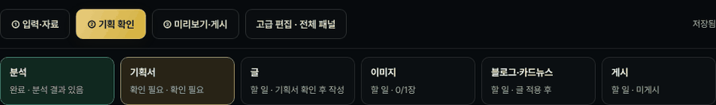
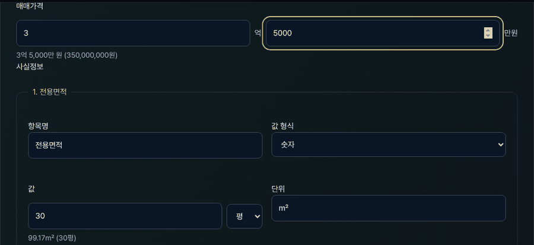
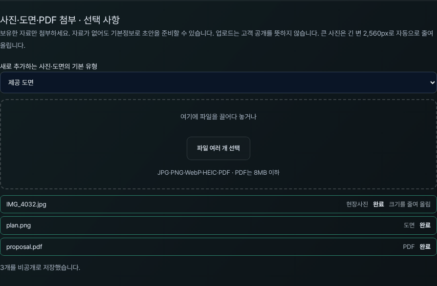
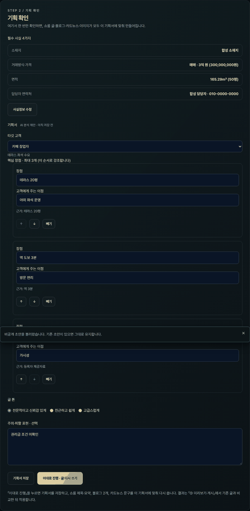
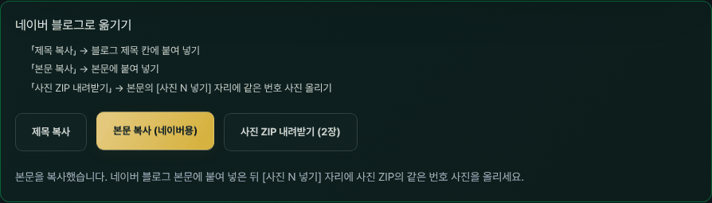
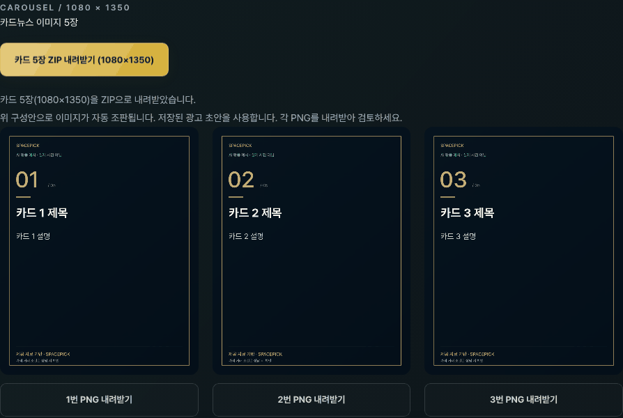
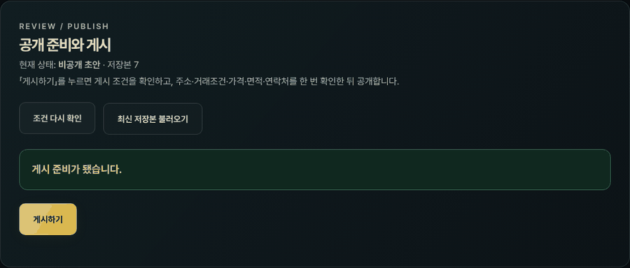
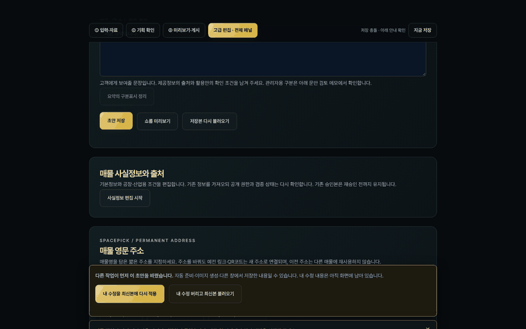

# 스페이스픽 관리자 사용 안내

매물 하나를 **입력 → 기획 확인 → 미리보기·게시** 세 단계로 공개하는 방법입니다. 관리자가 직접 확인할 곳은 두 군데뿐입니다.

1. **② 기획 확인**: AI가 정리한 기획서(누구에게, 무엇을 강조할지)가 맞는지
2. **③ 게시하기**: 주소·거래조건·가격·면적·연락처가 맞는지(확인창 한 번)

나머지(분석, 글 작성, 이미지, 블로그·카드뉴스 준비)는 AI 작업자가 처리하고, 화면 위쪽 진행 줄에 상태가 표시됩니다.

> 이 안내는 2026-11-13 `main` 기준 화면입니다. 화면 사진은 시험용 매물로 찍었습니다. 운영 사이트에 새 화면이 배포되기 전에는 버튼 이름이 다를 수 있습니다. 배포 상태는 [계획서](SPACEPICK_SIMPLIFICATION_PLAN.md)의 진행 기록을 보세요.

## 1. 로그인하고 매물 열기

1. **https://spacepick.kr/admin** 에 접속해 관리자 이메일과 비밀번호로 로그인합니다. 로그인은 그 탭에서만 유지되므로 새 탭에서는 다시 로그인합니다.
2. 새 매물은 **새 매물 입력**으로 시작합니다. 기존 매물은 아래 **등록 매물** 목록에서 **초안 열기**를 누릅니다.
3. 매물을 열면 분석 결과가 있으면 **② 기획 확인**, 없으면 **① 입력·자료** 화면이 먼저 열립니다.

### 단계 버튼과 진행 줄

- 위쪽 버튼으로 단계를 오갑니다. **고급 편집 · 전체 패널**은 모든 세부 패널을 한 화면에 펼칩니다(아래 7절).
- 진행 줄은 **분석 → 기획서 → 글 → 이미지 → 블로그·카드뉴스 → 게시** 순서입니다. 칸을 누르면 그 일을 하는 단계로 이동합니다. AI가 작업 중이면 15초마다 저절로 새로 고칩니다.
- 오른쪽 끝에 저장 상태가 보입니다(5절).

## 2. ① 입력·자료

### 기본정보 입력

소재지, 거래방식(매매·임대), 가격, 면적을 입력합니다. 모르는 값은 비워 둡니다.

- **가격**은 억과 만원 칸에 나눠 씁니다. 예: `3`억 `5000`만원 → 아래에 `3억 5,000만 원 (350,000,000원)`으로 확인됩니다.
- **면적**은 단위를 **평** 또는 **㎡**로 고를 수 있습니다. 평으로 넣어도 ㎡로 바꿔 저장하고 둘 다 보여 줍니다. 예: `30평` → `99.17㎡ (30평)`.
- **정보 사용 권한을 확인**하면 주소·거래조건·가격·면적은 기본으로 **공개**가 됩니다. 숨기고 싶은 값만 「값 공개 범위」를 비공개로 바꿉니다.

### 사진·도면·PDF 올리기

1. 파일을 상자에 끌어다 놓거나 **파일 여러 개 선택**으로 한꺼번에 고릅니다.
2. 목록에서 파일마다 유형(도면·현장사진)을 고릅니다. PDF는 자동으로 문서로 분류됩니다.
3. 등록 권한을 체크하고 **N개 자료 비공개 보관**을 누릅니다.

- 큰 사진은 브라우저에서 긴 변 2,560px로 줄여서 올립니다(“크기를 줄여 올림” 표시).
- 아이폰 HEIC 사진은 브라우저가 읽을 수 있으면 JPG로 바꿉니다. 읽지 못한다는 안내가 나오면 아이폰 **설정 › 카메라 › 포맷**을 「높은 호환성」으로 바꾸고 다시 찍거나 JPG로 내보내 올립니다.
- PDF는 8MB 이하만 올라갑니다. 실패한 파일은 그 파일만 다시 올리면 됩니다.
- 올린 자료는 비공개입니다. 고객에게 보이는 것은 게시할 때 고른 사진뿐입니다.

### 분석 요청

자료 분석 패널에서 **저장된 자료로 분석 시작**을 누릅니다. 진행 줄의 「분석」 칸이 **진행 중 → 완료**로 바뀌면 ② 단계로 넘어갑니다. 창을 닫아도 요청은 남습니다.

## 3. ② 기획 확인

AI 분석에서 만든 기획서를 확인하는 화면입니다. 이후 글·이미지·블로그·카드뉴스가 모두 이 기획서를 따릅니다.

| 항목 | 확인할 것 |
| --- | --- |
| 타깃 고객 | 누구에게 파는 매물인지. 목록에서 고르거나 **직접 입력…** |
| 핵심 장점 · 최대 3개 | 강조할 장점과 고객에게 주는 이점. ↑↓로 순서를 바꾸면 그 순서로 강조합니다. |
| 글 톤 | 글의 말투 |
| 주의·피할 표현 · 선택 | 쓰면 안 되는 표현(예: 확정되지 않은 수익률) |
| 필수 사실 4가지 | 소재지·거래방식·가격·면적이 들어 있는지. 빠진 값은 **사실정보 수정**으로 ① 단계에 가서 채웁니다. |

- 처음 열면 「AI 분석 제안 · 아직 저장 전」으로 표시됩니다. 고칠 것만 고치면 됩니다.
- **이대로 진행 · 글 다시 쓰기**를 누르면 기획서를 저장하고, 그 기획서로 글 다시 쓰기를 요청한 뒤 ③ 단계로 이동합니다.
- 수정만 저장하고 나중에 진행하려면 **기획서 저장**을 누릅니다.

## 4. ③ 미리보기·게시

### 새 글 비교·적용

글 다시 쓰기가 끝나면 진행 줄의 「글」 칸이 **새 글 비교·적용 필요**가 됩니다. **다시 글작성** 패널에서 기존 글과 새 글을 비교하고, 쓰고 싶은 항목만 골라 적용합니다.

### 이미지 만들기

글을 적용하면 진행 줄 아래에 **이미지 만들기 (N장)** 버튼이 나옵니다. 누르면 확인창에 예약 금액이 나옵니다.

- 1장에 최대 **250원**을 예약하고, 매물 하나에 **2,500원(10번)** 까지만 씁니다. 남은 예산보다 많이 요청하지 않습니다.
- 운영 설정 `WEB_API_IMAGES_ENABLED`가 꺼져 있으면 “API 이미지 생성이 운영 설정에서 꺼져 있습니다”라고 나옵니다. 이때는 **고급 편집**의 **Gemini 웹 이미지 가져오기**로 직접 만든 그림을 올립니다([Gemini 웹 이미지 프롬프트](IMAGE_PROMPTS.md)).

### 네이버 블로그로 옮기기

1. **제목 복사** → 네이버 블로그 글쓰기의 제목 칸에 붙여 넣습니다.
2. **본문 복사 (네이버용)** → 본문에 붙여 넣습니다. 소제목·굵은 글씨가 유지됩니다.
3. **사진 ZIP 내려받기** → 압축을 풀고, 본문의 `[사진 N 넣기]` 자리에 같은 번호의 사진을 올립니다.

### 카드뉴스 내려받기

**카드 5장 ZIP 내려받기 (1080×1350)** 로 인스타그램 세로 비율 카드 5장을 받습니다. 한 장씩 받으려면 카드 아래 **N번 PNG 내려받기**를 누릅니다. 외부에 자동으로 올리지는 않습니다.

### 영문 주소

**매물 영문 주소**에서 영문 소문자·숫자·하이픈으로 3~64자 주소를 정하고 **영문 주소 저장**을 누릅니다. 예: `https://spacepick.kr/yeoju-logistics`(형식 예시). 다른 매물이 쓰는 주소는 쓸 수 없고, 주소를 저장해도 게시 전에는 공개되지 않습니다.

### 게시하기

1. **쇼룸 미리보기**로 고객 화면을 확인합니다.
2. **게시하기**를 누르면 확인창이 한 번 뜹니다: “고객에게 공개됩니다. 주소·거래조건·가격·면적·담당자 연락처가 맞는지 확인하셨나요?” **확인**을 누르면 공개됩니다.
3. **공개 쇼룸 열기 ↗**로 고객 화면을 확인합니다. 로그아웃한 창(시크릿 창)에서 한 번 더 보면 확실합니다.

게시 패널의 안내는 두 종류입니다.

- **참고 · 게시는 가능합니다**: 이미지가 없거나 도면 확인이 남은 경우 등. 게시는 됩니다.
- **먼저 처리할 작업 N개**: 저장하지 않은 수정, 비어 있는 필수 정보, 공개로 바꾸지 않은 면적 등. 안내 옆 **해결할 위치로 이동 →** 을 누르면 고칠 곳이 열립니다. 면적만 남았다면 **입력한 면적 공개** 버튼 한 번으로 해결됩니다.

게시한 뒤 고친 내용은 **변경사항 게시하기**를 다시 눌러야 고객 화면에 반영됩니다. 그 전까지 고객은 이전 게시본을 봅니다.

## 5. 저장과 충돌

- 입력하면 **5초 뒤 자동으로 저장**됩니다. 오른쪽 위에 「저장 전 수정 있음 · 곧 자동 저장」→「저장 중…」→「자동 저장됨 (시각)」이 차례로 보입니다. 바로 저장하려면 **지금 저장**을 누릅니다.
- 저장하지 않은 수정이 있을 때 창을 닫거나 새로 고치면 브라우저가 한 번 묻습니다.
- 광고 문안과 입력 원문은 각 패널의 저장 버튼으로 따로 저장합니다(상태 표시에 함께 안내됩니다).

다른 창이나 AI 작업이 먼저 같은 매물을 저장하면 아래 안내가 나옵니다. 내 수정은 화면에 그대로 남아 있습니다.

- **내 수정을 최신본에 다시 적용**: 최신 저장본을 불러와 내가 고친 항목만 다시 얹어 저장합니다. 보통 이것을 누르면 됩니다.
- **내 수정 버리고 최신본 불러오기**: 내 수정을 버리고 최신 저장본으로 바꿉니다.

## 6. 거래 완료와 게시 중단

- 거래가 끝났지만 주소는 남기려면 영문 주소 패널의 **거래 완료로 표시**를 누릅니다. 고객에게 거래 완료를 알리고 새 문의를 받지 않습니다. 다시 소개할 때는 **문의 접수 다시 열기**를 누릅니다.
- 고객 화면에서 내리려면 게시 패널의 **게시 중단**을 누릅니다. 매물이 삭제되지는 않습니다.

## 7. 고급 편집

**고급 편집 · 전체 패널**에서는 세 단계에 없는 세부 패널도 모두 열립니다: 이미지 설정, Gemini 웹 이미지 가져오기, 문서 추출 후보와 원문 대조, 활용 콘셉트, 도면 구역 편집, 광고 문안 직접 수정 등. 평소에는 쓰지 않아도 됩니다. 게시 패널의 **해결할 위치로 이동 →** 이 필요한 패널을 자동으로 열어 줍니다.

## 8. 자주 막히는 경우

| 화면 상황 | 할 일 |
| --- | --- |
| 「다른 작업이 먼저 이 초안을 바꿨습니다」 | **내 수정을 최신본에 다시 적용**을 누릅니다(5절). |
| 게시하기를 눌렀는데 「먼저 처리할 작업」이 나옴 | **해결할 위치로 이동 →** 으로 가서 고치고 저장한 뒤 다시 **게시하기**를 누릅니다. |
| 「입력한 면적을 공개로 바꾸고 저장했습니다」 | 막힘이 풀렸다는 뜻입니다. **게시하기**를 다시 누릅니다. |
| 분석 칸이 오래 「진행 중」 | 작업자가 정기 실행에서 처리합니다. **처리 상태 확인**을 눌러 보고, 오래 그대로면 운영 담당자가 [운영 안내](ADMIN_WEB_OPERATIONS.md)로 작업자 상태를 확인합니다. |
| 이미지 버튼이 없음 | 기획서가 없거나, 이미 모든 자리에 이미지가 있거나, 생성 중입니다. 진행 줄의 「이미지」 칸 설명을 확인합니다. |
| 「남은 이미지 예산이 부족합니다」 | 매물당 2,500원을 다 썼습니다. 고급 편집의 Gemini 웹 이미지로 직접 올립니다. |
| HEIC 사진을 읽지 못함 | 아이폰 카메라 포맷을 「높은 호환성」으로 바꾸거나 JPG로 내보내 올립니다. |
| 고쳤는데 고객 화면이 그대로 | 저장 후 **변경사항 게시하기**까지 눌렀는지 확인합니다. |
| 새 탭에서 로그인 화면이 나옴 | 로그인은 탭마다 따로입니다. 다시 로그인합니다. 저장된 매물은 그대로 있습니다. |
