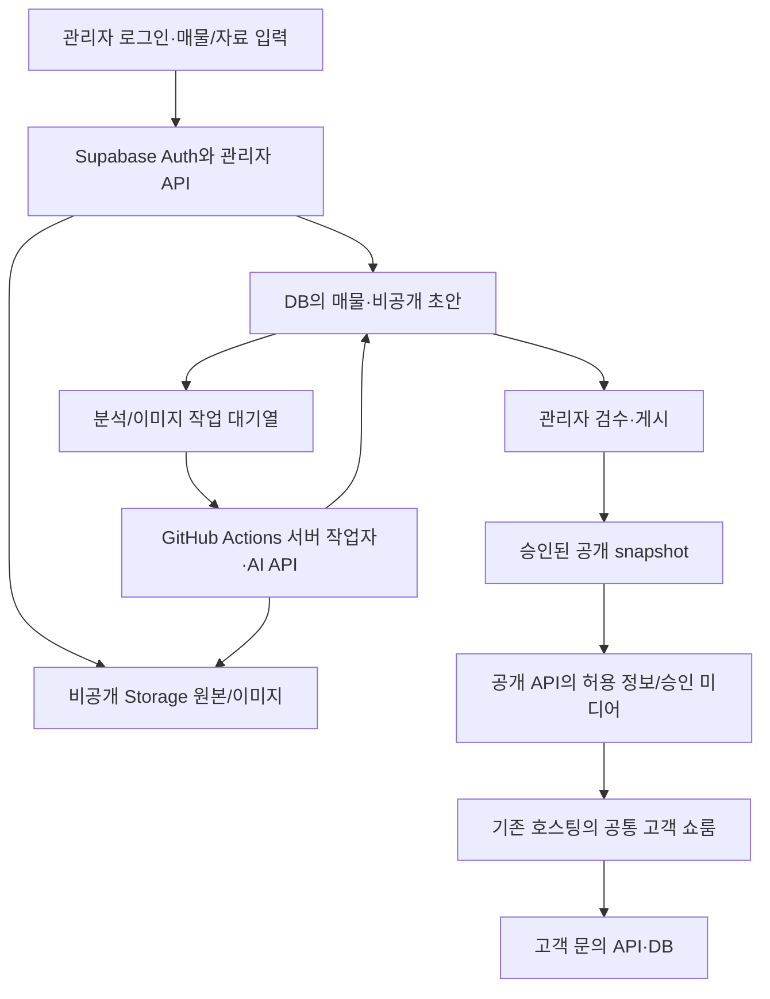

# SpacePick 실제 구현 기준 아키텍처

2026-11-07 추가: 아래는 기존 구현의 구조다. 향후 관리자 웹 주 입력·전용 작업자로 전환하는 목표 구조/작업 순서는 [전환 실행계획](../SPACEPICK_ADMIN_WEB_TRANSITION_PLAN.md)에 구분했다. 계획을 작성했으며 아직 기존 Actions 실행 경로를 바꾸지 않았다.

2026-11-06 (한국시간). 사용자가 제공한 ‘GitHub + Supabase + 웹 호스팅’ 설명을 실제 체크아웃과 대조했다. 이는 로컬 소스/설정 점검이며 운영 DB 스키마·호스팅 설정을 원격으로 읽었다는 뜻이 아니다.

## 유지할 구조

공통 쇼룸과 Supabase 데이터를 사용한다. 매물별 HTML을 생성해 운영하는 방식으로 바꾸지 않는다. 앞서 제공한 단일 HTML은 고객 화면을 검토하기 위한 별도 미리보기 파일이며 운영 매물 저장/게시 방식이 아니다.

도식은 로컬 구현의 책임 분리다. 작업자 자격증명과 미적용 migration/함수가 운영에 실제 연결되어 있는지는 배포 때 확인한다.

## 설명 문서와 코드의 대응

| 역할 | 현재 코드/설정 | 판단 |
| --- | --- | --- |
| 소스·버전 관리 | `easyhan79/Momentum_Pick` | 유지. 일반 매물 레코드/고객 원본을 코드로 저장하지 않음 |
| 웹 호스팅 | `.openai/hosting.json`의 프로젝트와 `build-worker.mjs`의 Worker 산출물, 기존 `chatgpt.site` 주소 | Netlify 사용 근거 없음. 임의 이전하지 않음 |
| 로그인/등록 권한 | Supabase Auth, 관리자 API의 `app_metadata.showroom_admin` 검증 | 현재 관리자 모델 유지. 중개사/조직별 멀티테넌트 완성을 의미하지 않음 |
| 매물/초안/승인본 | `properties`, `property_showrooms` | 초안과 승인된 공개본 분리 |
| 유형별 상세 | `draft_content.propertyProfile`과 fact/출처/공개 범위 | 논리 설계의 property_details 테이블을 중복 생성하지 않음 |
| 콘셉트 | 초안/승인본 JSON의 concepts | 별도 property_concepts 테이블을 임의 생성하지 않음 |
| 파일/이미지 | `property_assets`, 기존 private media bucket, 승인된 공개 미디어 전달 API | 공개용 버킷을 새로 만들 필요 없음. 보호된 전달도 설명 문서가 허용한 방식 |
| AI 처리 | `property_analysis_jobs`, `property_image_jobs`, 서버 작업자와 GitHub Actions | 비동기 처리·재시도/실패 상태 분리. 키를 고객 브라우저에 넣지 않음 |
| 문의 | `property_inquiries` 및 CRM 관련 테이블/API | 기존 API 재사용. 선택 자료는 문의 memo에 포함 |
| 주소 | `/영문이름`, 기존 `?p=주소` 호환/이전 주소 처리 | 설명의 `/p/:slug`는 예시. 기존 공개 경로를 임의 변경하지 않음 |

## 두 가지 게시/배포를 구분

| 작업 | 바뀌는 것 | 사이트 재배포 |
| --- | --- | --- |
| 새 매물 등록·사진/도면 추가 | DB/Storage의 데이터 | 불필요 |
| 매물 설명·가격 수정 후 초안 저장 | draft_content와 revision | 불필요. 기존 승인본은 유지 |
| 검수 후 매물 게시·재승인 | published_content/published_revision, 승인 기록 | 불필요. 공개 API가 승인본을 조회 |
| 매물 게시 중지/거래 완료 | 쇼룸 공개/거래 상태 | 불필요. 공개 경로에서 상태 확인 |
| 고객 화면의 기능·디자인 변경 | 웹 프로그램과 정적 자산 | 필요. 현재 T11을 서버에 반영하는 작업이 여기에 해당 |
| Edge 함수/DB 계약 변경 | 서버 코드/migration | 해당 서버 적용 필요. 새 매물 등록과 별개 |

공개 페이지는 slug로 공개 API를 조회하며 승인 snapshot만 표시한다. 화면 복귀/주기적 확인 시 새 승인본을 다시 읽는다. 따라서 ‘설명 수정 후 즉시 반영’은 새 초안을 무검수로 노출한다는 의미가 아니라, 새로 승인한 데이터가 GitHub 커밋/웹 재배포 없이 표시된다는 의미다.

## 지금 할 일과 후속 범위

- 고객 정보 보강(T11)의 로컬 구현·검증과 배포 파일 준비는 완료. 데이터 기반 공통 쇼룸 구조를 새로 만드는 작업을 반복하지 않는다.
- 현재 남은 것은 기존 호스팅에 개선된 프로그램과 필요한 서버 변경을 실제 적용하는 T12다. 배포 승인은 이미 받았으며 `SPACEPICK_V2_DEPLOYMENT.md`의 연결/적용 순서를 따른다.
- 현재 이 대화의 GitHub API 접근은 Forbidden이고 사이트 게시/브라우저 조작 도구가 제공되지 않았다. 웹 브라우저에 열린 GitHub/Supabase의 로그인 세션을 API·배포 권한으로 간주하지 않는다. 이 설명 문서만으로 실행 연결이 생겼다고 판단하지 않는다.
- 실제 자격증명·현재 적용 이력을 확인하기 전에는 DB/함수/호스팅이 운영에 반영됐다고 표시하지 않는다. 현재 원격 배포는 미완료다.
- 중개사/조직별 권한, 매물 복제, 도면/사진 구조 일치의 자동 보장 등은 각각 추가 구현/검증 범위다. 문서에 기능이 나열됐다는 이유로 이미 완료라고 기록하지 않는다.

첨부 설명의 ‘첫 단계 분석만’은 참고 지시서 안의 문구다. 사용자의 기존 개발·배포 승인을 새 승인 요청으로 되돌리지 않으며, 실제 구조에 맞는 항목만 반영한다. 이번 점검으로 호스팅·테이블·URL을 바꾸지 않았다.
